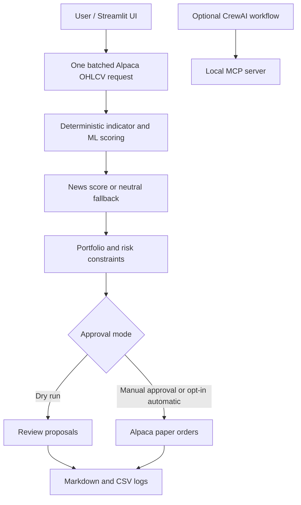

# Trade Algorithmically using Trading Agents

This project is a modular paper-trading workflow for US equities. It includes a local MCP server and CrewAI analysis workflow plus a deterministic Streamlit trading engine. The Streamlit execution path does not depend on LLM tool calls to calculate scores or submit orders.

## Objectives
- Trade US equities using Alpaca paper trading only.
- Support a portfolio of 30–45 tracked symbols, with an approximately 30% high-beta satellite sleeve.
- Provide a local MCP server that batches fetches OHLCV data and caches it in memory.
- Score symbols using technical, ML, news, and risk components.
- Generate portfolio decisions and human approval gates before paper orders.

## Architecture diagram



## Agent descriptions
- Market Data Agent: fetches OHLCV data in batch, validates symbols, and stores in the MCP cache.
- Technical Analyst: computes trend, momentum, volume, volatility, and statistical indicators.
- Quant / ML Analyst: builds features and estimates probability of positive forward return.
- News Analyst: fetches article summaries and converts them into a neutralized sentiment score.
- Signal Analyst: combines technical, ML, news, and risk signals into a deterministic composite score.
- Portfolio Strategist: ranks candidates, selects buy/sell/hold actions, and respects portfolio constraints.
- Risk & Execution Agent: validates order size, cash, and human approval before paper execution.

## MCP architecture
The project uses a local MCP server (`mcp_local_server.py`) instead of Alpaca's external MCP server. `crewai_workflow.py` starts that server as a stdio subprocess through `MCPServerAdapter`, attaches its tools to the relevant agents, and keeps the server connection open until the Crew finishes. It exposes tools for:
- Data: `fetch_ohlcv`, `fetch_ohlcv_batch`, `get_latest_prices`
- Technical: `calculate_all_indicators`, `calculate_trend_indicators`, `calculate_momentum_indicators`, `calculate_volume_indicators`, `calculate_volatility_indicators`, `calculate_statistical_indicators`
- Quant/ML: `generate_features`, `train_prediction_model`, `predict_return_probability`
- News: `get_stock_news`, `calculate_news_sentiment`
- Portfolio: `get_account_info`, `get_positions`, `get_open_orders`, `calculate_portfolio_exposure`
- Trading: `place_buy_order`, `place_sell_order`, `cancel_order`, `cancel_all_orders`

The app caches OHLCV data per symbol in memory so indicator calls do not trigger repetitive API requests. The feature, prediction, and news-sentiment MCP tools accept either a single ticker or a ticker collection. Batch-shaped requests return separate `results` and `errors` maps so one invalid ticker does not block the remaining symbols.

## Indicator list
- Trend: EMA20, EMA50, EMA200, ADX proxy
- Momentum: RSI, MACD, ROC, stochastic oscillator, TSI
- Volume: OBV, CMF, MFI, PVO
- Volatility: ATR, NATR, Bollinger Band Width, Donchian Channels
- Statistical: returns, rolling z-score, rolling skewness

## Scoring methodology
The final score is obtained deterministically in Python following:
- Technical Score = 60%
- ML Score = 20%
- News Score = 10%
- Risk Score = 10%

The component scores are normalized to 0–100 before aggregation.

Decision thresholds:
- 80–100: STRONG BUY
- 70–79: BUY
- 55–69: HOLD
- 40–54: WEAK HOLD
- 0–39: SELL

## ML methodology
The ML analyst creates a time-aware feature set from OHLCV and indicators and predicts the probability that the next 5-day forward return will be positive. It uses a time-based split and falls back to a simple rule-based model if scikit-learn is unavailable or training fails.

## Portfolio rules
- Maximum position size: 10% of portfolio value
- Minimum cash reserve: 0%
- Maximum new buys: configurable
- Maximum sells: configurable
- Avoid excessive concentration
- Account for high-beta satellite allocation
- Prefer current holdings before new buys

## Risk-management rules
- Validate available cash, current positions, and open orders
- Prevent duplicate/conflicting orders
- Calculate ATR-based stop-loss and take-profit approximations
- Permit human approval before execution when enabled

## Installation

```bash
python -m venv .venv
. .venv\Scripts\activate
pip install pandas numpy requests streamlit mcp crewai crewai-tools scikit-learn python-dotenv
```

## Environment variables
Copy `.env.example` to `.env` in the project root (the same folder as `trading_config.py`) and populate your paper credentials. The Streamlit app reads that file automatically; it does not ask for or display credentials. `NEWS_API_KEY` is optional; leave it empty for neutral news scores. Restart Streamlit after editing `.env`.

Example:

```bash
ALPACA_API_KEY=your_alpaca_paper_key
ALPACA_SECRET_KEY=your_alpaca_paper_secret
ALPACA_BASE_URL=https://paper-api.alpaca.markets
ALPACA_SECONDARY_API_KEY=your_second_paper_account_key
ALPACA_SECONDARY_SECRET_KEY=your_second_paper_account_secret
ALPACA_SECONDARY_BASE_URL=https://paper-api.alpaca.markets/v2
NEWS_API_KEY=
PAPER_TRADING_MODE=false
```

Keep the existing account's values in `ALPACA_API_KEY`, `ALPACA_SECRET_KEY`, and `ALPACA_BASE_URL`. Add the new paper account's key and secret to the three `ALPACA_SECONDARY_*` variables; do not replace or delete the original values. Both credential pairs are read from the project-root `.env` beside `trading_config.py`, and the app sends each order to the corresponding paper account. The trading URL builder accepts either a host-only base URL or one ending in `/v2`, so the supplied secondary URL will not get a duplicate `/v2` path. Restart Streamlit after editing `.env`. Never paste credentials into source code or commit `.env`.

## Run CLI

```bash
python cli.py --symbols AAPL MSFT NVDA AMZN GOOGL TSLA --lookback-days 180 --timeframe 1Day
```

## Run Streamlit

```bash
streamlit run streamlit_app.py
```

## Dry-run instructions
Set `PAPER_TRADING_MODE=false` to run:
- data fetch
- technical analysis
- ML scoring
- signal combination
- portfolio plan generation
- proposed order review without Alpaca orders

## Paper trading instructions
The Streamlit UI defaults to analysis-only. Paper buys require selecting individual recommendations, enabling paper order submission, and explicitly approving the selected orders. Orders go only to `https://paper-api.alpaca.markets`; the app does not use a live trading endpoint.

The app can use two distinct Alpaca paper accounts and scans the bundled S&P 500 universe to produce separate ranked recommendations for the three virtual student buckets. Kunal, Navroop, and Kavya each have a persistent virtual $100,000 bucket in `logs/portfolio_ledger.sqlite3`, for a combined virtual budget of $300,000. Filled orders are attributed to the student bucket and broker account that generated them, and the UI shows combined budget, deployed virtual capital, available bucket cash, and P&L, without broker account equity/cash figures. Orders use the primary account first, then route to the secondary account when the primary has insufficient capacity; proposals are shared across students in turns. Each student bucket has a 10% maximum position and no cash-reserve target.

Each Alpaca account's actual cash, equity, buying power, existing positions, and open orders are checked independently before order submission; funds are not transferred between accounts, and no discretionary cash reserve is subtracted. A student's full $100,000 virtual bucket may be invested, subject to per-position, available buying power, existing holdings, and pending orders. The broker accounts must collectively have sufficient buying power to fund the orders, and the code rejects configuring the same Alpaca account twice. A ticker already held or pending in either account is not bought again; each tracked holding is attributed to the student and account whose order created it, and sells are sent to that account.

The app scans a rotating set of 60 symbols from the bundled S&P 500 list; a stable hash ordering selects a new 60-symbol slice every two days, using fixed 48-hour periods aligned to UTC. Existing Alpaca holdings are added to each scan even when they are outside the current slice, so they can be evaluated for exits. The app ranks available stocks and assigns 10 new recommendations to each student. Manual per-student watchlists have been removed. For this 10-stock selection, the regular BUY/STRONG BUY score threshold is bypassed: even HOLD, WEAK HOLD, or SELL-scored selections can become buy proposals. Existing broker holdings get a sell/exit proposal on a SELL model signal, a 2-ATR loss from average entry, or a 3-ATR gain from average entry. Unassigned holdings are included too. Sell proposals are not automatic: select each desired sell, enable paper trading, and explicitly approve it before submission. The app attempts up to 10 new buys per student per run, but does not guarantee 30 orders: market data, existing/pending positions, the accounts' available buying power, and per-student position caps still limit proposals and submissions. Each order requires the configured approval flow. The bundled constituent list is a static snapshot and should be reviewed periodically.

To reduce Alpaca API usage, each two-day scan evaluates 60 rotating candidates plus current holdings, identical historical-bar batches are cached in memory for five minutes, pending student orders are reconciled from one recent-orders request where possible, and Alpaca requests are paced at no more than two per second. Historical-bar batches follow Alpaca pagination tokens so the 10,000-bar response-page limit does not leave requested symbols without data. Rate-limited requests honor `Retry-After` with bounded retries; if retries are exhausted, the error identifies the limited API host and endpoint. Repeated analysis within the cache window reuses the recent bars; paper buys still refresh latest trade prices immediately before submission.

Existing Alpaca positions that were opened outside this ledger are shown as unassigned. If a sell signal is generated, they can be selected and submitted to the account that holds them; their proceeds are not attributed to a student bucket. The ledger must be kept with the project between runs; deleting it resets virtual bucket ownership and cash tracking.

Before submission, the engine refreshes Alpaca latest-trade prices for buys and recalculates whole-share quantities against current account buying power and student budget limits. Paper orders are market orders; ATR stop and target levels are evaluated during each analysis but are not broker-side standing orders. A move through the threshold between analyses will not trigger a sale until another analysis is run and the proposed sell is selected and approved.

### Start paper trading

1. Keep the original paper-account key/secret in `ALPACA_API_KEY` and `ALPACA_SECRET_KEY`. Put the second paper account's key/secret in `ALPACA_SECONDARY_API_KEY` and `ALPACA_SECONDARY_SECRET_KEY`. Leave `ALPACA_BASE_URL=https://paper-api.alpaca.markets`; set `ALPACA_SECONDARY_BASE_URL=https://paper-api.alpaca.markets/v2`. Never put live credentials in this project.
2. From the project directory, run `streamlit run streamlit_app.py`. Credentials load from `.env`; they are not entered in Streamlit.
3. For a dry run, leave **Enable Alpaca paper-order submission** unchecked, then click **Analyze group portfolio**. The app scans the current two-day 60-stock S&P 500 slice plus all current account holdings, generates recommendations, and proposes triggered holding exits.
4. In **Recommendations & Alpaca Trading**, check the buys and/or exits you want, enable **Enable Alpaca paper-order submission**, check the approval box, and click **Submit selected paper trades**. The app submits only selected proposals. Available buying power, bucket limits, open orders, and position caps can leave fewer orders than selected. Review execution results and verify orders in the Alpaca paper dashboard.
5. Open the **Current Holdings, P&L & Trade Status** tab and click **Refresh holdings and trade status** to fetch broker holdings, unrealized P&L, recent order statuses, and student-bucket P&L. Refresh after orders have had time to fill.

Start with manual approval and small paper orders. Paper orders are market orders; the displayed ATR stop-loss/take-profit levels are informational and are not placed with the broker. The app is not a continuously running scheduler; you must run each trading cycle from Streamlit. Paper trading is not real trading and does not guarantee performance.

Each run writes a timestamped report under `reports/`; submitted/rejected order results are appended to `logs/paper_orders.csv`.

## Experiment methodology
- Select 10–15 stocks per student, with a group portfolio of 30–45 names.
- Use a 15–20 day paper-trading evaluation window.
- Maintain one environment for paper-only trading.
- Record decisions, scores, and order details in timestamped markdown logs.

## Logging structure
Each analysis writes a timestamped markdown report in `reports/`. Paper-order results are also appended to `logs/paper_orders.csv`.

## Limitations
- The system expects a valid Alpaca paper account and network access.
- News integration is optional and neutral if no API key is configured.
- The ML model is intentionally lightweight and explainable rather than a production-grade strategy engine.
- Local LLM availability is required if using Ollama.

## Future improvements
- Add richer portfolio optimization and diversification constraints.
- Add more robust factor models and hyperparameter tuning.
- Add CSV export and dashboard charts for scoring history.
- Add out-of-sample backtesting and performance metrics.
